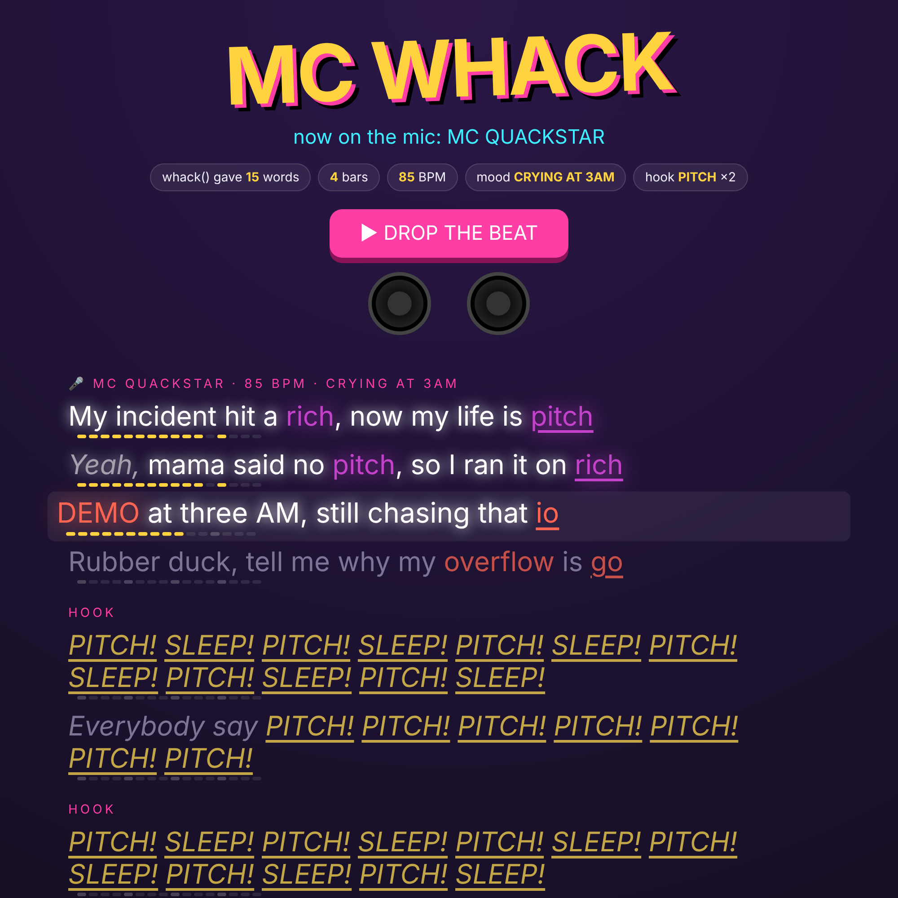
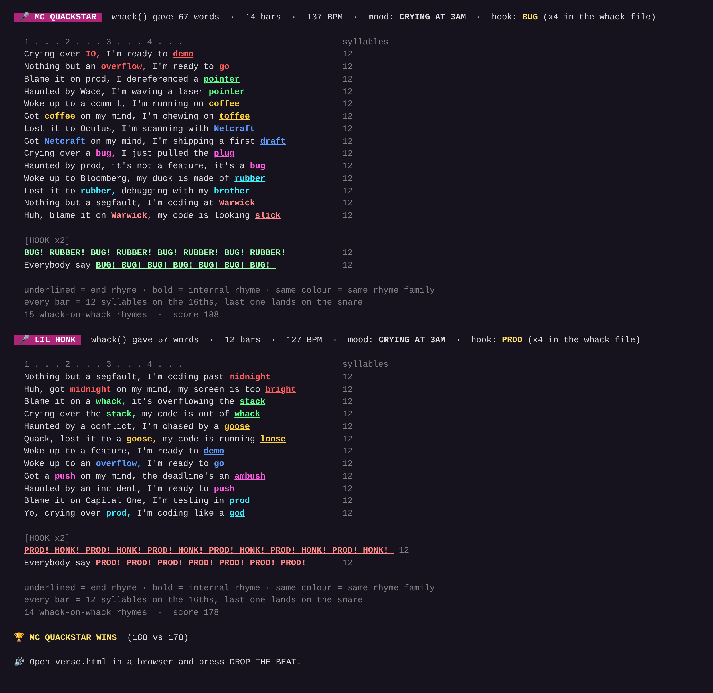

# MC WHACK 🎤🦆

**By:** Felix Lyon

**Pitch:** every call to `whack()` becomes a rap verse, and then a live performance with a synth beat, a robot rapper and karaoke lyrics. You can also have two MCs battle it out with their own `whack()` calls.

## How to run it

```
python3 spit.py            # one verse
python3 spit.py --battle   # two MCs, two whack() calls, one winner
```

Each run prints the verse to the terminal, with the rhyming words colour-coded, and writes `verse.html`. Open that page in a browser and press **DROP THE BEAT**. No installs, no API keys, just Python 3 and a browser.

**No Python? Run it in your browser:** [open the live player](https://raw.githack.com/felixlyon12/one-hour-hack-26/claude/wizardly-wozniak-arq1va/submissions/felixlyon12/player.html). Opening `player.html` on its own loads [Pyodide](https://pyodide.org) and runs the real `spit.py` and the unchanged `whack.py` in the browser (`whack()` writes its `whack` file to Pyodide's in-memory file system). Every refresh and every 🎲 NEW BATTLE is a fresh `whack()` call. `example_battle.html` is one saved battle.

## How `whack()` writes the song

Nothing is hand-picked. Every part of the song comes from `whack()`:

| `whack()` gives… | …which decides |
|---|---|
| **how many words** (1–100) | how many bars (4–16) and the **BPM** (71–170) |
| **the order of the words** | which rhyme families the verse uses, in order. All 42 words sit in rhyme families (`whack/hack/quack/stack`, `io/overflow/demo`…), and each couplet is built on one |
| **the `whack` file** | the most-repeated word in the file becomes the **HOOK**, and the hook spends every copy of it ("Everybody say GOOSE! GOOSE! GOOSE!…") |
| **sponsor words vs suffering words** | the mood: **FLEXING** ("Sponsored by bloomberg, yeah I'm flexing on…") or **CRYING AT 3AM** ("Ten cups of coffee and I'm still on…") |
| **everything else** | the first half of each bar is built around one of the other words |

## Bars that make sense *and* fit the beat

- **No word is used more times than `whack()` drew it.** Each verse gets a word budget: a word drawn 3 times can appear at most 3 times, and words that weren't drawn can't appear at all. The budget covers the hand-written halves too ("Capital One" spends `capital` and `one`). When the budget runs dry, a bar opens with a neutral phrase like "Listen up," instead.

- **Every bar is a real sentence.** The first half is built around a `whack()` word, with the right article ("Blame it on **the stack**,", "Shout out to **Bloomberg**,"). The second half is one of about 110 hand-written closers that end on a rhyme ("…my code is out of **whack**").
- **Rhymes inside the line.** When `whack()` gives a word that rhymes with the closer, it goes in the first half: *"Blame it on a **whack**, it's overflowing the __stack__"*, *"Got a **segfault** on my mind, and it's all my __fault__"*.
- **Every bar is exactly 12 syllables.** A hand-tuned syllable counter knows that `semicolon` is 4 and `io` is 2. The generator picks the opener, `whack()` word and closer that come closest to 12, then pads with ad-libs ("yo,", "skrrt,", "quack,").
- **Each syllable has its own 16th note.** The last syllable, the rhyme, lands on the snare. In the player, every word lights up on its note, and a beat grid under each line fills in as it plays.

## Screenshot




